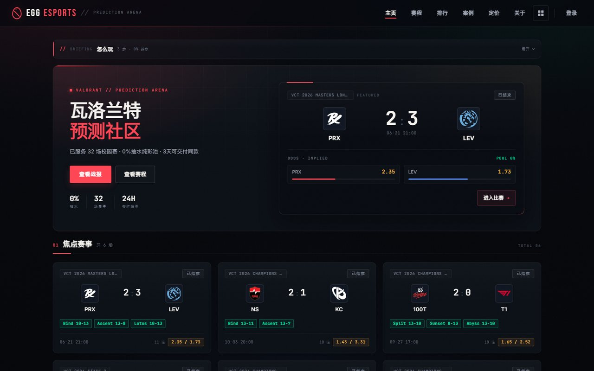
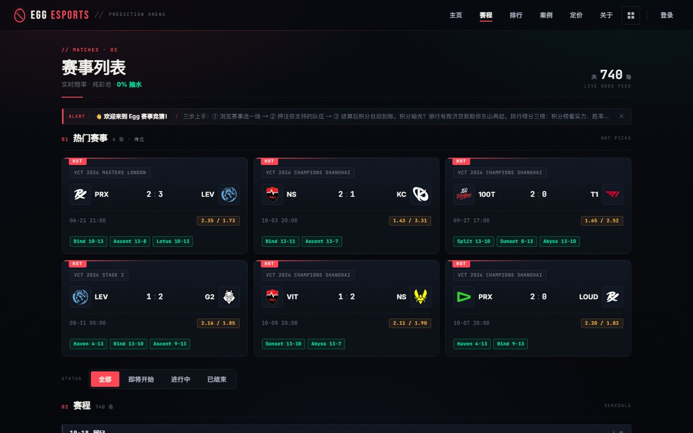
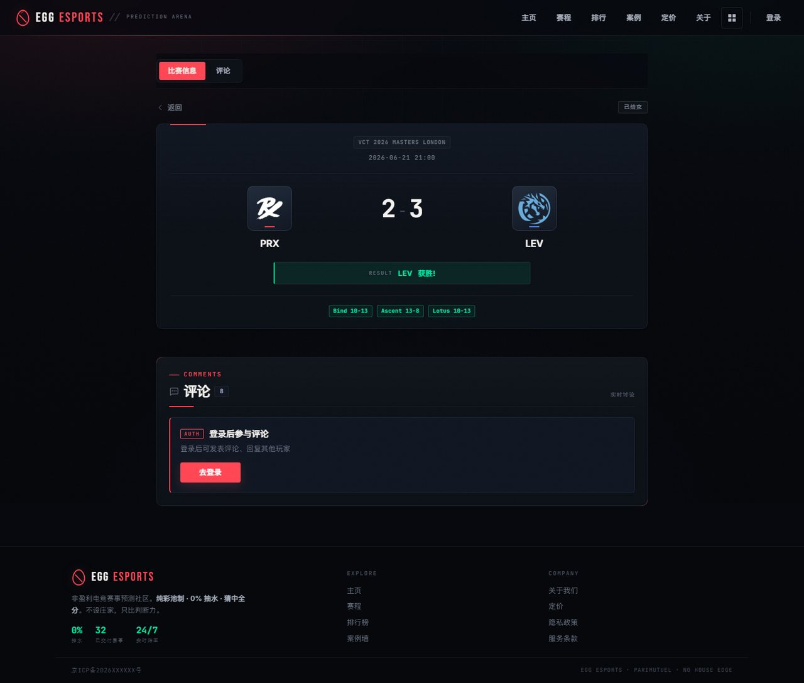
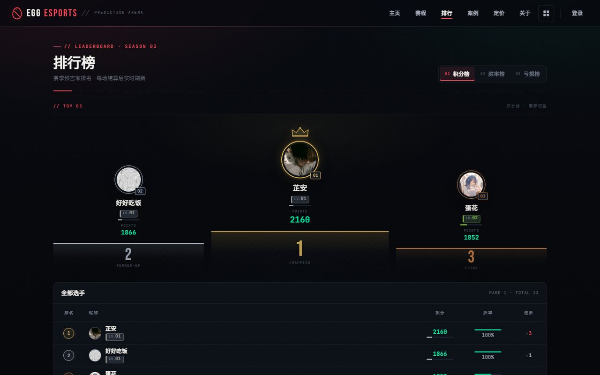
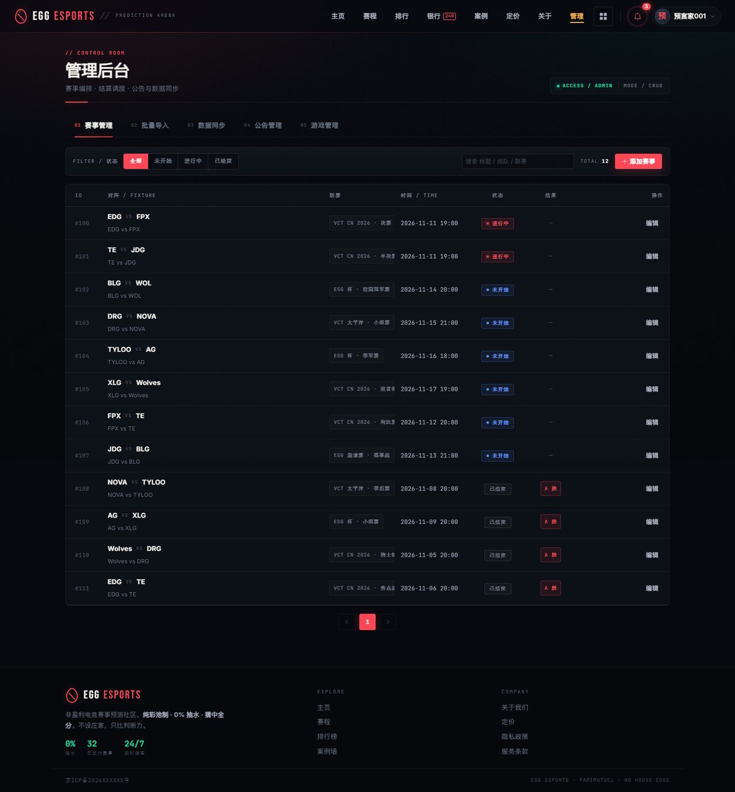
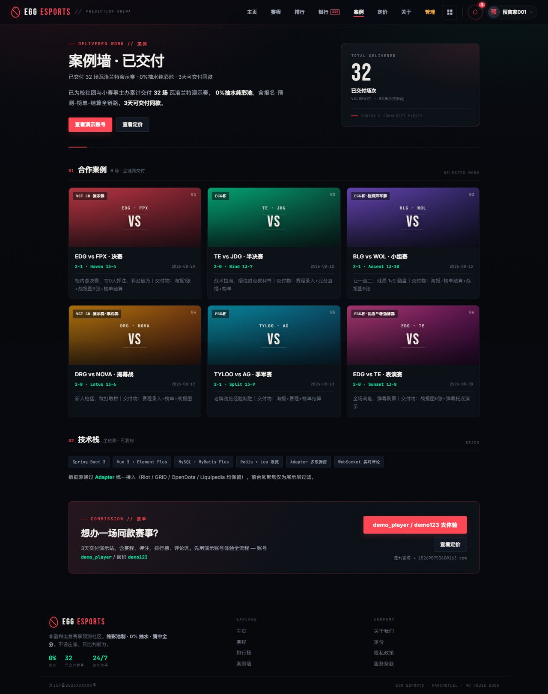
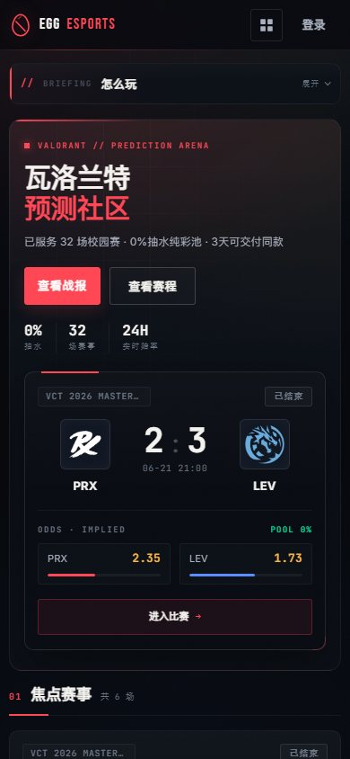
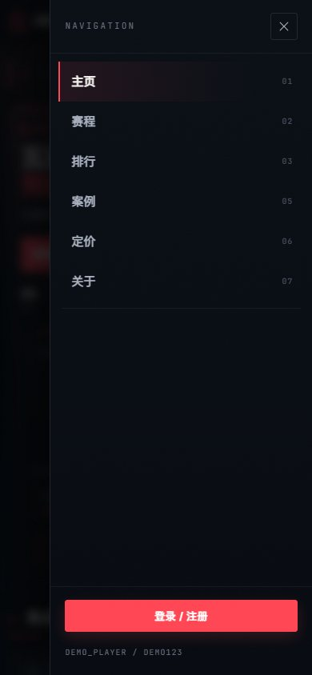

# 🥚 Egg Esports

> 电竞赛事预测演示平台 — 纯彩池制（Parimutuel），0% 抽水，猜中按比例分池。

[](https://spring.io/projects/spring-boot)
[](https://openjdk.org/)
[](https://vuejs.org/)
[](https://www.mysql.com/)
[](https://redis.io/)
[](#license)

一个可完整跑起来的全栈示例项目：**Spring Boot 3 + Vue 3**，覆盖赛事数据同步、押注/改注、动态赔率、自动结算、排行榜、实时评论与后台管理。前端为暗黑电竞风 UI v2，桌面与移动端双端适配。

- 后端：Spring Boot 3.0.6 / Java 17 / MyBatis-Plus / WebSocket / JJWT
- 前端：Vue 3.4 / TypeScript / Element Plus / Pinia / Vite 5
- 存储：MySQL 8（业务数据）+ Redis 7（限流与缓存）

> 积分仅用于演示与竞技，不可充值、不可提现、不可变现。

---

## 界面预览

> UI v2 · 桌面 1440 / 移动端 390 实测 · 320–430px 无横向溢出

| 首页 · Hero / 焦点赛 | 赛程 · 日期分组 / 赔率 |
| --- | --- |
|  |  |

| 比赛详情 · 记分牌 / 评论区 | 排行榜 · 三榜 / Level |
| --- | --- |
|  |  |

| 管理后台 · Control Room | 案例墙 · 演示场景 |
| --- | --- |
|  |  |

| 移动端 · 首页 | 移动端 · 抽屉导航 |
| --- | --- |
|  |  |

---

## 功能特性

- **纯彩池制赔率**：赔率 = 总彩池 / 单边彩池，0% 抽水，不设庄家
- **Adapter 多数据源**：`GameSourceAdapter` 统一接口，内置 Riot / LoL / OpenDota / GRID 等适配器，新增游戏只需实现一个 Adapter
- **押注全链路**：下注 → 改注 → 截止 → 结算，彩池与积分变更带乐观锁校验
- **自动结算**：定时任务拉取赛果并结算，支持手动触发
- **排行榜**：积分榜 / 胜率榜 / 亏损榜三榜，支持按游戏过滤
- **实时评论**：WebSocket 推送，比赛详情页评论即时可见
- **三层鉴权**：JWT Token → LoginInterceptor → `@RequireAdmin` AOP
- **Redis + Lua 限流**：Redis 不可用时自动降级为内存限流
- **后台管理**：赛事创建/编辑/结算、数据源同步、公告与用户管理
- **演示数据一键灌入**：`POST /api/seed/demo` 生成赛程、榜单与评论（含机器人托底）
- **大列表性能**：700+ 场赛程默认只渲染最近 18 个比赛日，按需「加载更早」

## 技术栈

| 层级 | 技术 | 说明 |
|------|------|------|
| 后端 | Spring Boot 3.0.6 + Java 17 | REST API + WebSocket |
| ORM | MyBatis-Plus 3.5.3 | 注解式 SQL，Lambda 查询 |
| 数据库 | MySQL 8.0 | InnoDB，utf8mb4 |
| 缓存 | Redis 7 | Lua 限流 + 内存降级 |
| 鉴权 | JJWT 0.11.5 | HS256，7 天过期 |
| 前端 | Vue 3.4 + Element Plus 2.7 | 暗黑电竞风 UI v2，响应式 320–430px |
| 构建 | Vite 5 | 按需引入，Gzip |
| 部署 | Docker Compose / Nginx + systemd | HTTPS，反向代理，限流 |

## 支持游戏

| 游戏 | 数据源 | 状态 |
|------|--------|------|
| **瓦洛兰特 (Valorant)** | Riot Esports API | 默认展示（`gameId=1`） |
| 英雄联盟 | LoL Esports API | 适配器保留（`gameId=2`） |
| Dota 2 | OpenDota | 适配器保留（`gameId=3`） |
| CS2 | GRID | 适配器保留（`gameId=4`） |

> 前台默认聚焦瓦洛兰特，其他游戏的 Adapter 全部保留，显式传 `gameId=2/3/4` 仍可查询。开关见 `application.yml` 的 `egg.sync.adapters.*`。

---

## 项目结构

```
egg-esports/
├── egg-server/                # Spring Boot 后端
│   └── src/main/java/com/egg/esports/
│       ├── common/            # 公共组件（JWT、拦截器、限流、异常处理）
│       ├── config/            # 配置类（Redis、WebSocket、CORS、Swagger）
│       ├── module/            # 业务模块
│       │   ├── user/          # 用户（注册、登录、资料、头像）
│       │   ├── match/         # 比赛（列表、详情、创建、结算）
│       │   ├── bet/           # 押注（下注、修改、查询、结算）
│       │   ├── game/          # 游戏目录
│       │   ├── comment/       # 评论（WebSocket 实时推送）
│       │   ├── announcement/  # 公告
│       │   ├── notification/  # 通知
│       │   ├── leaderboard/   # 排行榜（积分 / 胜率 / 亏损）
│       │   ├── loan/          # 积分救济与自动还款
│       │   ├── audit/         # 操作日志（AOP 审计）
│       │   ├── odds/          # 动态赔率
│       │   ├── bot/           # 机器人托底
│       │   ├── dev/           # 演示数据灌入（SeedController）
│       │   └── sync/          # 外部数据同步（Adapter 模式）
│       └── sync/              # 数据源适配器（Riot、OpenDota、GRID 等）
├── egg-web/                   # Vue 3 前端
│   └── src/
│       ├── views/             # 页面（首页、赛程、排行、用户中心、案例墙等）
│       ├── components/        # 组件（押注面板、评论区、管理后台等）
│       ├── router/            # 路由配置
│       ├── stores/            # Pinia 状态管理
│       ├── utils/             # 工具（Axios、WebSocket、格式化）
│       └── styles/            # 全局样式（暗黑主题）
├── deploy/                    # 部署文件（systemd、备份脚本）
├── docs/                      # 设计文档 + 界面预览
│   ├── preview/               # 界面截图（桌面 / 移动端）
│   ├── 设计分析文档.md         # 架构、数据库、API、类图、时序图
│   ├── 需求说明文档.md         # 用户故事、功能需求
│   └── 上线计划书_v2.md        # 版本路线图
├── docker-compose.yml         # 本地全栈编排（MySQL + Redis + 后端 + 前端）
└── .github/workflows/ci.yml   # CI（后端测试 + 前端构建）
```

---

## 快速开始

### 环境要求

- JDK 17、Maven 3.9+
- Node.js 20+
- MySQL 8.0、Redis 7
- 或 Docker + Docker Compose（一键起全栈）

### 方式一：Docker Compose（推荐）

```bash
git clone https://github.com/denglizibinghua/egg-esports-open.git
cd egg-esports-open

cp .env.example .env
# 编辑 .env：数据库密码、Redis 密码、JWT_SECRET（至少 64 字符）
# 可用 openssl rand -base64 48 生成 JWT_SECRET

docker compose --env-file .env up -d --build
```

- 前端：<http://localhost>
- 后端 API：<http://localhost:8088>
- Swagger UI：<http://localhost:8088/swagger-ui.html>

### 方式二：本地手动启动

```bash
# 1. 初始化数据库
mysql -u root -p < docs/init.sql

# 2. 配置环境变量（参考 .env.example）
#    DB_PASSWORD / REDIS_PASSWORD / JWT_SECRET / RIOT_API_KEY 等

# 3. 启动后端
cd egg-server
mvn spring-boot:run          # http://localhost:8088

# 4. 启动前端
cd egg-web
npm ci --legacy-peer-deps
npm run dev                  # http://localhost:8080，代理 /api /uploads /ws → 8088
```

### 灌入演示数据

`POST /api/seed/demo` 需要管理员权限。首次使用请先注册一个账号，再将其提升为管理员：

```sql
UPDATE egg_user SET role = 1 WHERE username = '你的用户名';
```

然后登录获取 Token 并调用：

```bash
curl -X POST http://localhost:8088/api/seed/demo \
  -H "Authorization: Bearer $TOKEN"
```

灌入后会生成 18 场瓦洛兰特比赛、25 人榜单、每场 8–12 条评论，首页三个区域、排行榜与评论区均非空。

灌入同时会创建两个普通演示账号（密码均为 `demo123`）：

| 账号 | 昵称 | 初始积分 | 用途 |
|------|------|----------|------|
| `demo_player` | 预言家001 | 5000 | 押注、评论、冲榜 |
| `demo_new` | 新用户 | 100 | 体验低积分与救济流程 |

## 配置说明

所有敏感配置均通过环境变量注入，仓库不包含任何真实密钥。完整清单见 `.env.example`。

| 变量 | 说明 |
|------|------|
| `DB_PASSWORD` | 业务库密码（Docker 中 `egg` 用户的密码） |
| `MYSQL_ROOT_PASSWORD` | Docker MySQL root 密码（裸机部署可忽略） |
| `REDIS_PASSWORD` | Redis 密码 |
| `JWT_SECRET` | JWT 签名密钥，至少 64 字符 |
| `RIOT_API_KEY` | Riot Esports API Key（拉取瓦洛兰特赛程） |
| `GRID_API_KEY` | GRID API Key（CS2 数据源） |
| `EGG_CORS_ORIGINS` | 允许的跨域来源，逗号分隔 |

> 生产环境请务必覆盖所有默认值，并通过 `--spring.profiles.active=prod` 启动（`application-prod.yml` 中密码与密钥均为必填、无默认值）。

## 架构要点

- **Adapter 模式**：数据源统一为 `GameSourceAdapter` 接口，同步任务按配置装配适配器，新增游戏无需改动核心逻辑
- **纯彩池制**：赔率 = 总彩池 / 单边彩池，0% 抽水
- **三层鉴权**：JWT Token → `LoginInterceptor` → `@RequireAdmin` AOP
- **乐观锁**：彩池更新、积分变更、押注操作均带版本/条件校验
- **限流降级**：Redis + Lua 限流，Redis 不可用时自动降级为内存限流
- **外部调用**：`@Retryable` + HttpClient5 连接池，失败可重试

## API 文档

启动后端后访问 Swagger UI：<http://localhost:8088/swagger-ui.html>

## 文档

- [设计分析文档](docs/设计分析文档.md) — 系统架构、ER 图、API 列表、类图、时序图
- [需求说明文档](docs/需求说明文档.md) — 用户故事、功能需求、非功能需求
- [上线计划书](docs/上线计划书_v2.md) — 版本路线图与优先级

## 贡献

欢迎 Issue 与 PR。提交前请确保：

```bash
# 后端
cd egg-server && mvn test

# 前端
cd egg-web && npm run build && npm run lint
```

安全问题请勿公开提 Issue，参见 [SECURITY.md](SECURITY.md)。

## License

[MIT](LICENSE) © 2026 Egg Esports

## 免责声明

本项目为技术演示与学习用途。积分不可充值、不可提现、不可变现，不提供任何现金博彩功能；请勿将本项目用于任何违法违规场景。
